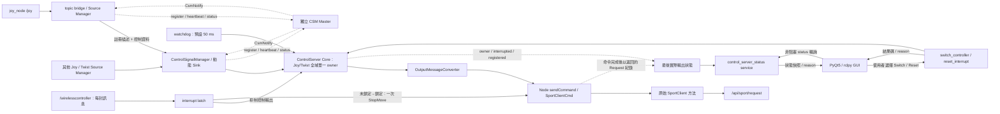

# Control Server 現行架構、服務與控制權仲裁

查核日期：2026-10-20。Server 基線為已合併 `r1` commit `edc9ad1`／v0.2.1，transport 為 v0.2.0／`5a91d31`。本輪在此基礎新增獨立 PyQt5／rclpy GUI client，使用既有三個操作服務，不修改 server、Core、interfaces 或 thirdparty 行為。`ControlServerStatus` 與三個 services 已隨 `r1_interfaces` v0.1.3 的 [PR #3](https://github.com/cocobird231/r1_interfaces/pull/3) 合併，主線 SHA 為 `dc3e199`，與原 release commit `34e5d1e` 的 tree 相同。Server 的 CMake 與 manifest 明確要求 interfaces ≥0.1.3，不能用既有 v0.1.2／`a0530d7` 代替。本文件不代表新增 GUI 已發布或已完成桌面／實機驗收。

## 1. 目前行為摘要

- Server 接收已註冊來源的 Joy／Twist，兩種型別共同競爭**一個全域 active controller**，再轉成 Unitree sport request。
- 健康的 active 不會被較高 priority 的**普通資料**搶走。較高 priority 的來源要送 **request-active 訊號**才會接管；相等 priority 不可接管。
- 普通收訊／watchdog 發現 active 不可用時，跨型別選 priority 最高的可用來源，同分先依 channel、再依 type 字典順序選擇；request-active 在沒有可用 active 時則直接選請求者。
- 三個操作服務提供狀態查詢、依 `controller_name` 手動切換，以及明確解除 wireless interrupt。手動 RPC 要求來源同時為 transport `ACTIVE` 與本地可用，不比較 priority。
- R2／Twist sentinel 急停仍不比較 priority、也不限 active 來源；這條路徑本身不鎖存。它與 wireless interrupt、active Joy 的 X 按鍵 StopMove 是不同操作。
- `/wirelesscontroller` 的**每一封** `unitree_go/msg/WirelessController`，包括全零與重複訊息，都觸發全域 interrupt latch。首次鎖定發布一次 StopMove；鎖定期間抑制 server 所有後續控制輸出，直到明確 reset。
- 桌面 GUI 以 status service 顯示狀態，以 switch／reset service 執行使用者操作；沒有直接 robot publisher，不改變 server 的仲裁或輸出時機。

下文的「active」指 server 選中的控制來源；R1 status 的 `STATE_ACTIVE` 只表示訊號存活，兩者不能混用。

## 2. 組件與資料流



| 組件 | 目前責任 | 主要實作 |
|---|---|---|
| `ControlServerNode` | 建立操作服務與 wireless subscription；`sendCommand()` 執行命令後，以返回的已發布 request 與來源 controller 紀錄輸出 | [control_server.cpp](../src/control_server.cpp) |
| `control_server_gui` | 顯示三服務回覆、輪詢狀態、送出使用者選擇的 switch／reset；服務失聯、逾時或尚在等待時限制操作 | Python package `rv2_server_control_gui` |
| R1 `ControlSignalManager` | 管理來源註冊、建立 Sink、接收資料、追蹤存活狀態、與 master 對帳 | transport 的 `r1/control_signal_manager.h` |
| `ControlServer` | 記錄各 channel 收訊、跨型別選單一 active、處理急停／失聯、wireless latch 與手動操作 | [control_server.h](../include/rv2_server_control/control_server.h) |
| `OutputMessageConverter` | 保存 Joy 按鍵與速度去重狀態，將需要輸出的普通訊息轉成 `SportClientCmd` | [output_message_convert.h](../include/rv2_server_control/output_message_convert.h) |
| `SportClient` | 由既有 vendor 方法填入並發布 `unitree_api/msg/Request`；thirdparty 內容維持 `9d6143b` 基線 | [sport client](../thirdparty/unitree_ros2_client/ros2_b2_sport_client.cpp) |
| CSM Master | 偵測 Manager 存活與兩端註冊不一致，通知相關 Manager；不選擇機器人的 active controller | transport 的 `r1/csm_master.h` |

Transport 傳遞 priority，但不替 consumer 仲裁；選擇政策在 `ControlServer`。Core mutex 序列化收訊仲裁、watchdog、interrupt／reset／switch 與 output callbacks，callback 應保持簡短且不阻塞。訊息型別仍各自保存 records 與轉換 callback，控制權則只有一個。

[Production launch](../launch/control_server.launch.py) 預設另外啟動一個 master；已有 master 時用 `start_master:=false`。直接 `ros2 run rv2_server_control control_server` 不會啟動 master。

## 3. 目前提供哪些 services

### 3.1 Control Server 操作服務

三個名稱皆由 `config.name`（`server_name` 參數）加上後綴組成。預設 prefix 是相對名稱，會套用 node namespace；以下列出根 namespace 的結果。若 `server_name` 以 `/` 開頭則為絕對名稱，ROS remapping 仍有效。

| 預設 service | 型別 | Request／結果 |
|---|---|---|
| `/control_server/control_server_status` | `r1_interfaces/srv/ControlServerStatusReq` | 空 request；回覆 `response`、`reason`、`status` |
| `/control_server/switch_controller` | `r1_interfaces/srv/SwitchControllerReq` | `string controller_name`；依 R1 主鍵選擇，回覆 `response`、`reason` |
| `/control_server/reset_interrupt` | `r1_interfaces/srv/ResetInterruptReq` | 空 request；解除 wireless latch，回覆 `response`、`reason` |

Status／reset 的結果碼均為 `RESPONSE_SUCCESS=0`、`RESPONSE_ERROR=1`。Switch 使用以下 typed results；程式應看 `response`，不應解析診斷文字 `reason`。

| Switch 結果 | 值 | 意義 |
|---|---|---|
| `RESPONSE_SUCCESS` | 0 | 指定來源已選中；不表示已輸出或機器人已完成動作 |
| `RESPONSE_NOT_FOUND` | 1 | 此 controller 不在已註冊 Sink 清單 |
| `RESPONSE_NOT_ACTIVE` | 2 | 尚無可用收訊紀錄、資料過期／blocked，或 transport 尚非 `ACTIVE` |
| `RESPONSE_UNSUPPORTED_TYPE` | 3 | 已註冊型別沒有 server output handler |
| `RESPONSE_INTERRUPTED` | 4 | Wireless latch 尚未解除 |
| `RESPONSE_ERROR` | 5 | Server 無法完成操作或發生例外 |

手動切換可選較低 priority，也可在 Joy／Twist 間換手。拒絕不改 active 或觸發輸出；成功換手依一般換手規則停止舊輸出，等待新 owner 的下一封普通資料。已選中的有效 controller 可再次成功選擇，不重播資料。

Reset 在未鎖定時也是成功，且不更動既有正常控制。從鎖定狀態 reset 時清除 server 的各 type 收訊紀錄、active 與 converter 狀態，不發任何 request，也不取消 R1 註冊；恢復需有新的資料 callback。後續任何 wireless callback 都可再次鎖定，沒有「全零代表解除」或等待按鍵放開的例外。

### 3.2 Server 固定持有的 R1 管理服務

以下以根 namespace、`server_name=control_server` 為例。程式使用 `<server_name>/...`；預設是相對名稱，會加上 node namespace。若 `server_name` 以 `/` 開頭則為絕對名稱，不再前置 namespace；ROS remapping 仍可改變最終名稱。

| 預設 service | 型別 | 作用 |
|---|---|---|
| `/control_server/control_signal_manage` | `r1_interfaces/srv/ControlSignalManage` | Source Manager 註冊／取消註冊；server 建立／移除對應 Sink |
| `/control_server/control_signal_info_req` | `r1_interfaces/srv/ControlSignalInfoReq` | 空 request；查詢已註冊 endpoint 的完整 `source_list`／`sink_list` |
| `/control_server/get_notifications` | `r1_interfaces/srv/CsmNotify` | 接收 master 主動送來的異常／註冊不一致通知；雖然名稱是 get，實際是接收通知的入口 |

`control_signal_manage` 的 `op=0` 是 REGISTER，`op=1` 是 UNREGISTER。Request 包含 `source_manager_name`、`source_csm_instance_id`、`registration_id`、`attempt_generation` 與 `info`。REGISTER 需要完整描述；UNREGISTER 必須匹配原註冊 identity 三元組，不能只填 controller 名稱就刪除任意來源。

Response 包含 `response` 與 `reason`：0 SUCCESS、1 RETRYABLE_CONFLICT、2 TEMPORARY_UNAVAILABLE、3 PERMANENT_REJECTION、4 ALREADY_APPLIED、5 STALE、6 ERROR。**註冊成功只代表建立傳輸 endpoint，不代表取得 active 控制權。** 新註冊但尚未收到資料的來源不會自動被選中。一般應由 R1 Source Manager／handle 操作註冊，以維持 identity 與重試流程。

Info 查詢通常會看到 server 的 `sink_list`；production node 沒有建立控制資料 Source，因此 `source_list` 通常為空。Response 的結果碼為 SUCCESS／ERROR，沒有「目前 active controller」欄位。

`CsmNotify` 的 request 包含通知 `kind`、`peer_csm_health`、`event_id`、目標 incarnation 與 `EntryStatus[] entries`。通知種類為 STATE、CSM_TIMEOUT、DISCONNECTED、PAIR_MISSING；response 為 APPLIED、ALREADY_APPLIED、STALE、REJECTED 與 reason。這是生命週期協調，不是指定 active controller 的命令。

### 3.3 依 channel 動態建立的資料服務

| Source descriptor | Server 建立的 endpoint | Request／response |
|---|---|---|
| `type=joy, mode=service` | 名稱為 `channel_name`，型別 `r1_interfaces/srv/ControlSignalJoy` | Request：`sensor_msgs/msg/Joy data`；response：結果碼與 reason |
| `type=twist, mode=service` | 名稱為 `channel_name`，型別 `r1_interfaces/srv/ControlSignalTwist` | Request：`geometry_msgs/msg/Twist data`；response：結果碼與 reason |
| `mode=topic` | 名稱為 `channel_name` 的 Joy／Twist subscription | 沒有該 channel 的資料 service |

資料服務定義了 SUCCESS=0、REJECTED=1，但目前 Sink handler 在 `_store(req->data)` 後固定回覆 `SRV_RES_SUCCESS`，沒有將 server 仲裁結果放入 response。待命來源、priority 不夠的 request-active，或未產生 Unitree 輸出的訊息，都可能得到 service SUCCESS。**這不是取得控制權或機器人完成動作的 ACK。**

R1 bridge 預設 `controller_name=local_xbox`、`channel_name=topic_bridge_control`、`csm_mode=topic`、priority 80。因此 `/topic_bridge_control` 預設是資料 topic，不能當資料 service 呼叫。Server 也不會直接訂閱 `/joy`；bridge 先讀 `/joy`，再經已註冊的 channel 轉送。

### 3.4 Master 與 ROS 標準服務

| Service | 型別 | 持有者／用途 |
|---|---|---|
| `/csm_master/register` | `r1_interfaces/srv/CsmRegister` | 獨立 master 接受 Manager 名稱、instance ID、timeout／週期等設定；不是 controller 註冊 |
| `/csm_master/heartbeat` | `r1_interfaces/srv/CsmHeartbeat` | 獨立 master 接受 Manager 名稱與 instance ID 的 heartbeat |

Jazzy standalone node 使用預設 NodeOptions 時，另有下列標準服務：

| 預設 service | 型別 |
|---|---|
| `/control_server/describe_parameters` | `rcl_interfaces/srv/DescribeParameters` |
| `/control_server/get_parameter_types` | `rcl_interfaces/srv/GetParameterTypes` |
| `/control_server/get_parameters` | `rcl_interfaces/srv/GetParameters` |
| `/control_server/list_parameters` | `rcl_interfaces/srv/ListParameters` |
| `/control_server/set_parameters` | `rcl_interfaces/srv/SetParameters` |
| `/control_server/set_parameters_atomically` | `rcl_interfaces/srv/SetParametersAtomically` |
| `/control_server/get_type_description` | `type_description_interfaces/srv/GetTypeDescription` |

R1 管理端點 prefix 由 `server_name` 決定，標準服務 prefix 則來自 **ROS node 名稱**。改 `server_name` 不會自動改 node name。Master 的 R1 prefix 預設 `csm_master`，它自己的 node name 是 `csm_master_node`。使用 component container 時，還可能看到 container 自己的服務；logger services 並非 NodeOptions 預設啟用項目。

本版操作使用 §3.1 的三個具名服務，不使用 legacy `ControlServerReq`，也沒有修改 priority 的專用 service。標準參數服務不代替操作服務：server 設定在建構時讀取，沒有將參數變更套用到仲裁狀態的 callback。`set_parameters` 成功不表示 Manager 已重建或控制權已切換。

### 3.5 桌面 GUI 的服務邊界

`control_server_gui` 是獨立 ROS node，Python package 為 `rv2_server_control_gui`。它僅使用 §3.1 的 status、switch、reset，不訂閱控制資料或直接發布 `/api/sport/request`。預設每 500 ms 非阻塞輪詢 status，service timeout 為 2000 ms；兩者可用正整數參數 `poll_interval_ms`、`service_timeout_ms` 調整。輪詢沒有控制副作用，不會增加 Move 或改變 event-triggered 去重行為。

GUI 顯示 online／stale、interrupted、目前 owner、完整 registered table 與最後實際輸出欄位。表中的 registration 不能證明 transport ACTIVE 或 Core 資料仍新鮮；選列後按 Switch，只將 `controller_name` 送給 server，由 server 套用既有嚴格切換條件。Interruption 期間停用 Switch；reset 仍是使用者明確操作，遵守 §7 的不重播與下一封 wireless 再鎖定規則。

失聯或操作尚在等待時停用操作按鈕，錯誤顯示 typed result 與 `reason`。逾時只能判定 client 沒有及時收到回覆，不能斷言 server 沒執行；結果須由後續新的 status 確認。GUI 不因逾時而重送 switch／reset，不自動 reset，也不將本地選取列當成 server 已切換。Status 的最後輸出仍是 §9 的本地 publish 紀錄，不是 robot ACK；stale 畫面亦不保證仍反映目前 owner 或 interruption。

在已 source workspace 的桌面啟動：

```bash
# 預設只啟動 GUI；連線到既有 server
ros2 launch rv2_server_control control_server_gui.launch.py

# 同時啟動 server 與預設 master；joy／bridge 另行啟動
ros2 launch rv2_server_control control_server_gui.launch.py start_server:=true

# 指定完整 service prefix
ros2 run rv2_server_control control_server_gui --ros-args \
  -p server_name:=/robot/control_server
```

GUI `server_name` 預設 `control_server`，相對名稱沿用 node namespace，以 `/` 開頭的名稱為完整 service prefix。GUI launch 的 `start_server` 預設 false；`start_master=true` 只在啟動 server 時生效，已有 master 可設 false。`config_file` 指定 server YAML，`master_name` 留空時沿用 YAML；GUI launch 明確 forward `server_name`，會覆蓋 YAML 內設定，包括預設 `control_server`。其他 server 設定如 watchdog／log_output 使用 YAML，GUI launch 不另設同名參數。

正常使用需有 `DISPLAY` 或 `WAYLAND_DISPLAY`；headless 自動化測試使用 `QT_QPA_PLATFORM=offscreen`。視窗關閉與 SIGINT 會清理 GUI ROS node 並退出。GUI-only 模式不終止既有 server；組合 launch 在 GUI 結束時關閉整個 launch session，包含被 include 時同 session 的其他節點，不管理外部既有程序。

## 4. controller、channel、priority 分別代表什麼

R1 `ControlSignalInfo` 有八個欄位：

| 欄位 | 在目前 server 的用途 |
|---|---|
| `controller_name` | Manager 查找 Sink、識別來源的 key |
| `channel_name` | 真正資料 topic／service 名稱，也是每個 type 的 record key；全域 owner 由 `(type, channel)` 識別 |
| `target_manager_name` | 接收註冊的 Manager；預設 `control_server` |
| `mode` | `topic` 或 `service` |
| `type` | 訊息型別 key；production node 處理 `joy` 與 `twist` 的動作輸出 |
| `priority` | 1–100，越大越優先；用於 request-active 與候選來源選擇 |
| `timeout_ns` | 控制資料過期門檻；server 按本地最後收訊時間檢查 |
| `disconnect_timeout_ns` | Transport 判定端點終止並移除的門檻 |

每個來源應使用不同的 controller／channel 名稱。RPC `switch_controller` 接受 **controller_name**。既有 C++ `getActiveSink<T>()` 仍回傳 **channel_name**，但只有全域 owner 的 type 符合 `T` 時才非空；`setActiveSink<T>(channel)` 接受 channel，成功時會取代任何 type 的 owner。此 C++ API 保留 `usable()` 的可用性規則，容許剛收訊後尚未更新為 ACTIVE 的 INITIAL／TIMEOUT；RPC 額外嚴格要求 transport ACTIVE。兩者都不能越過 wireless latch。預設 bridge 的 controller 與 channel 分別是 `local_xbox`、`topic_bridge_control`。

Priority 是來源註冊描述的一部分。Server 沒有載入 `requester_priority.yaml`，也沒有 LOCAL／REMOTE 類別上限、95–99 保留區或 priority 100 急停特權。它不要求不同來源的 priority 互異。變更 priority 需由來源端更新描述／註冊流程；對同一 identity 重送 REGISTER 不是修改 priority 的 RPC。

## 5. 收到一封資料時的判斷順序

`registerTypeConfig<T>()` 安裝的 callback 依序執行：

1. 檢查 callback 進入時保存的 reset generation；如果等待 Core lock 期間已經 reset，丟棄此 callback。再取得 `controller_name` 對應的 Sink handle；無效或已 DISCONNECTED 就忽略。
2. 更新該 channel 的描述、handle 與本地收訊時間，清除之前的 `blocked`。若 wireless latch 已鎖定便結束，不執行急停／request-active／普通輸出；未鎖定時，同名 active 端點重建另外清理舊輸出狀態。
3. **先判斷 R2／sentinel 急停**：將發送者設為 blocked，跨型別從其餘可用來源重新選 active，發 StopMove，結束此封訊息。
4. **再判斷 request-active**：無可用 active 就直接選請求者；有則只有請求者 priority 嚴格較高才切換。無論成功與否，此封都不進入普通動作轉換。
5. **最後處理普通資料**：若 active 不可用，跨型別選最高 priority 的可用候選；只有這封的 `(type, channel)` 正是全域 owner，才呼叫 output callback。

非 active 的普通資料仍會刷新自身收訊紀錄，讓它成為可用 fallback；只是不送到機器人。沒有 active 時，第一封可用普通資料通常就取得控制權，不必等所有來源都註冊後再選全體最高 priority。

### 5.1 request-active 與急停編碼

| 訊息 | request-active | 急停 |
|---|---|---|
| Joy | `buttons[11] == 1`；不足 12 個按鍵則不成立 | axes 至少 6 個且 `axes[5] < 0.5`，對應目前 R2 mapping |
| Twist | `linear.z`、`angular.x`、`angular.y` **全部等於 99** | 同三個欄位**全部等於 -99** |

Joy 同時滿足兩者時，先走急停。Twist sentinel 不作一般 Move 值；普通運動使用 `linear.x`、`linear.y`、`angular.z`。

Joy request-active 是持續按住的電平判斷，不是按下邊緣。持續送 `buttons[11]=1` 只會持續請求／保活，不輸出 Move；取得控制權後要再送普通訊息才進入動作轉換。

### 5.2 何謂「可用」來源

`usable()` 要求：未 blocked、handle 有效、狀態非 DISCONNECTED，且未超過本地最後收訊時間加 `timeout_ns`。它不要求 Manager 狀態剛好等於 `STATE_ACTIVE`：Manager 在自己的 tick 更新狀態，新資料到達時 status 可能暫時仍是 INITIAL／TIMEOUT。

自動仲裁因此能立即處理第一封資料；手動 `switch_controller` 則必須同時通過上述檢查與 transport ACTIVE，且紀錄描述仍符合目前註冊內容。註冊已成功但尚未收到資料的 controller 會出現在 status 清單，切換仍回 `RESPONSE_NOT_ACTIVE`。

`timeout_ns=0` 停用資料 timeout；R1 service mode 不接受 0，topic mode 才可使用。`disconnect_timeout_ns=0` 停用自動斷線移除。兩門檻都從最後活動時間計算；非零 disconnect 必須大於非零 timeout。

## 6. 切換條件與優先權範例

| 觸發情況 | 選擇規則 | 輸出行為 |
|---|---|---|
| 無可用 active，收到普通資料 | 在已有新鮮紀錄中挑最高 priority | 若本封來自選中的 channel，就進入 output callback |
| Active 健康，其他來源送普通資料 | 保持原 active，即使來訊 priority 較高 | 只更新候選紀錄 |
| 收到 request-active | 無可用 active 就選請求者；有則必須嚴格較高 priority | 換手先停止舊輸出，再等新 owner 的普通資料 |
| Watchdog 發現 active 過期／失效 | 跨型別最高 priority；同分依 channel、再依 type 字典順序；沒有則清空 | 停止舊輸出，不重播候選最後一封資料 |
| RPC `switch_controller` | 指定 controller 已註冊、支援型別、transport ACTIVE 且本地可用；不比較 priority | 可選較低 priority 或另一 type；換手後等新普通資料 |
| C++ `setActiveSink<T>(channel)` | 指定 type／channel 可用即可；不比較 priority | 取代全域 owner，保留比 RPC 寬鬆的首次收訊規則 |
| 收到 R2／sentinel 急停 | 封鎖發送者，再跨型別選其他可用候選 | 直接發 StopMove，該封不送普通輸出 |
| 收到 wireless 訊息 | 清空全域 owner 並鎖存 interrupted | 只有未鎖定→鎖定時發一次 StopMove，鎖定期間其餘輸出皆抑制 |
| `reset_interrupt` | 已鎖定時清除 server 紀錄與 latch，R1 註冊保留 | 不發輸出，不重播；未鎖定時保持原狀 |

一般換手時，若舊來源曾進入 output callback，`stopPrevious()` 會先發一次 StopMove，再更新 active、清除 converter 狀態。切換本身不重播快取命令。切到相同 `(type, channel)` 時一般不重複換手；同名端點重建另有狀態清理流程。

內部 `hadOutput` 記錄是否曾進入 output callback，用來決定失聯／換手的停止邊緣。即使 converter 因零值／同值去重而沒有發布，後續失聯仍可能 StopMove。它不同於公開 status 的 `has_output`：後者只有真實 publish 才設為 true，且會保留最後輸出歷史。

以下來源都是 Joy，候選資料尚未過期；數字僅示範規則，並非內建角色表。

| 狀況 | 結果 |
|---|---|
| A priority 20 先送普通資料，B priority 80 後送普通資料 | A 保持 active；B 待命 |
| B priority 80 再送 request-active | B 接管，先停止 A；B 下一封普通資料才可輸出 |
| A priority 20 對健康的 B priority 80 送 request-active | 不切換 |
| C priority 80 對健康的 B priority 80 送 request-active | 不切換，必須嚴格較高 |
| B 失聯，A priority 20 與 C priority 80 仍有新鮮資料 | 選 C；不是恢復最早取得控制權的 A |
| B 失聯，`alpha` 與 `beta` 同 priority 且可用 | 選 `alpha`，比較的是 channel 名稱 |
| RPC 選擇 ACTIVE 且新鮮的 A，或程式對可用的 A 呼叫 `setActiveSink<Joy>(A_channel)` | A 可取代較高 priority 的 B；兩種入口有不同的 ACTIVE 檢查 |

跨型別也採相同規則。例如 Joy A priority 20 已控制機器人，Twist B priority 80 的普通資料不會搶權；B 的 request-active 可接管，之後只有 B 的新普通資料能輸出。A 的失聯不會另行打斷健康的 B。若兩個候選同 priority，先比 channel；type 僅在 channel 也相同時決定次序。

## 7. R2／X、失聯與 wireless 鎖存的邊界

**R2／Twist sentinel 急停與「X 按鍵 StopMove」是不同路徑。** 未被 wireless 鎖定時，R2／sentinel 在 active 篩選前處理，任何有有效端點的來源都能觸發，不比較 priority。X 屬於 active Joy 的普通動作轉換；非 active 的 X 不會通過輸出篩選。

X 的 StopMove 不切換 active，也不重設速度去重狀態。因此按 X 停止後，如果後續速度值完全相同，未必會重新發布 Move；不能把它等同於仲裁急停後的同值恢復流程。

R2／sentinel 急停將發送者 blocked 並跨型別重新選候選，也可能把控制權從原本健康的低 priority active 轉給待命的高 priority 來源。發送者下一封非急停訊息解除自己的 blocked；其他選中來源下一封普通訊息也能再次 Move。這條路徑不設 wireless latch，無須 reset service。

未被 wireless 鎖定時，每一封 R2／sentinel 急停都執行 stop callback，連續急停可能連續發 StopMove。失聯則在沒有新的輸出活動時，不會於每個 watchdog tick 重複停止；wireless 的一次停止以 latch 的未鎖定→鎖定邊緣計算。

Wireless subscription 使用 `rclcpp::SensorDataQoS()`，即 best-effort、volatile、keep-last 5；可接收 best-effort 或 reliable publisher。型別固定為 `unitree_go/msg/WirelessController`，不是 `unitree_hg/msg/LowState` 的 raw `wireless_remote` 陣列。預設 topic 是 `/wirelesscontroller`，可透過啟動參數 `wireless_topic` 改名。

Callback 不檢查 lx／ly／rx／ry／keys 的值，也不做邊緣或重複內容過濾。**全零、持續相同內容、沒有按鍵的訊息都會鎖定。** 第一次鎖定先設 interrupted、清空 owner 與轉換狀態，再發布一次 StopMove；該輸出的 `output_controller_name` 為空。即使尚未有控制器輸出也會停止。已鎖定期間重複 wireless 訊息不重複 StopMove；Joy／Twist 的普通資料、request-active、R2／sentinel、watchdog 與手動切換都不再產生控制輸出。

Reset 本身不發 Move 或 StopMove，不清除最後實際輸出的 metadata。它清空 server 已保存的收訊紀錄，並拒絕在 reset 前已進入、但等待 Core lock 的舊 callback。**它不清空 DDS 佇列**：reset 後才開始執行的 callback 仍被視為新 callback，其資料可能早已由 publisher 送出；目前無 producer sequence／age gate 保證資料是在 reset 後產生。若 wireless 持續發布，即使持續全零，下一封 callback 仍會再次鎖定；需要停止該資料流後再 reset，才能保持解除狀態。

一般換手、仲裁 stop callback、wireless interrupt／reset 會清空 Joy 與 Twist 全部 converter 狀態。上述仲裁與抑制只約束本 server 的輸出；其他直接發布 `/api/sport/request` 的程序不受此 latch 控制。

## 8. 時間設定與輸出

| 設定 | 預設 | 含義 |
|---|---|---|
| `watchdog_interval_ms` | 50 ms | Server 檢查 active 資料是否可用的週期 |
| `status_timer_interval_ms` | 100 ms | R1 Manager tick／status 週期 |
| `csm_timeout_ms` | 600 ms | Master 判斷本 Manager heartbeat 過期並標記 TIMEOUT 的門檻，不是 Joy 資料 timeout |
| `csm_disconnect_timeout_ms` | 6000 ms | Master 判斷本 Manager 已死亡、通知配對 Manager 移除相關端點的門檻 |
| `wireless_topic` | `/wirelesscontroller` | 每封訊息都觸發 wireless latch 的 subscription 名稱 |
| Source `timeout_ns` | 來源決定 | 目前 R1 bridge 的 `timeout_ms=2000` |
| Source `disconnect_timeout_ns` | 來源決定 | 目前 R1 bridge 的 `disconnect_timeout_ms=10000` |

Master 依最後收到本 Manager heartbeat 的時間判斷存活；上述兩個 CSM 門檻不表示 server 等待 master 回覆的時間。Server 預設值見 [control_server.yaml](../config/control_server.yaml)。實際停止時間還受 executor 排程、callback 與 watchdog 檢查時間影響，50 ms 不是端到端停止保證。

普通 Move 是事件驅動：必須收到全域 active 的新普通資料 callback，且轉換後的速度值相較該 channel 保存的值有變化，才會發布。Active Joy 的 axes 0／1／3 轉成 Move x／y／yaw；active Twist 使用 linear.x／linear.y／angular.z。沒有 Move 重發 timer；持續收到相同速度也不反覆發布 Move，停止收訊時更不會重播最後命令，初始全零通常不發 Move。

Joy 的 A／B／X／Y 由 `JoyInterpreter` 的 PRESS 邊緣事件分別產生 StandUp／StandDown／StopMove／RecoveryStand。按鍵保持按下不會反覆觸發同一個按鍵動作。R2／Twist sentinel 是例外的安全路徑：未被 wireless 鎖定時，每一封符合條件的急停訊息都發 StopMove，不做按下邊緣去重。Wireless 則只在 latch 的未鎖定→鎖定邊緣發一次 StopMove。

Watchdog 雖然週期執行，只在資料失效／換手需要停止舊輸出時發一次安全 StopMove，不週期發 Move。R1 heartbeat、Manager tick 與 status 發布也屬週期工作，但不會重發機器人運動命令。Reset 不發輸出；switch 可先停止舊 owner，但不重播新 owner 的快取資料。換手、仲裁 stop、wireless interrupt／reset 或端點重建會重設 converter；之後仍要等新的普通資料 callback，才按新的去重狀態判斷是否輸出，因此相同非零值可恢復。X 的普通 StopMove 不走此 reset。

輸出是 `/api/sport/request` 的 `unitree_api/msg/Request` **topic**，不是 ROS service。現行路徑發布命令，不等待機器人完成確認。它是絕對 topic 名稱，替 server 換 namespace 不會自動將 robot 輸出隔離成不同 topic。

## 9. 狀態語意與操作命令

`control_server_status` 回覆的 `ControlServerStatus` 包含：

| 欄位 | 意義 |
|---|---|
| `stamp`、`server_name` | Node 讀取狀態後填入 ROS clock 時間，以及 server 的設定名稱 |
| `interrupted`、`active_controller_name` | Wireless latch 與唯一選中的 controller；沒有 owner 時名稱為空 |
| `registered_controllers` | Manager 的完整已註冊 Sink 描述；包含尚未送資料的來源，不是 Core 收訊 records 的清單 |
| `has_output` | 此 server 曾實際 publish 過 request；StopMove 後仍為 true，不代表機器人正在移動 |
| `output_stamp`、`output_controller_name` | 最後本地 publish 的 ROS clock 時間與來源 controller；wireless safety stop 的 controller 為空 |
| `output_api_id`、`output_parameter`、`output_binary` | 最後實際發布的 API ID、parameter 字串及 binary bytes；`has_output=false` 時不具輸出意義 |

Server 狀態與最後輸出 metadata 在同一 Core lock 下複製；Manager 註冊清單使用自己的 lock，註冊可在兩部分取樣間改變。`stamp`／`output_stamp` 使用 ROS clock，與 watchdog 的本地 steady clock 分開；ROS 時間為零時仍可用 `has_output` 判斷是否真的有過輸出。

輸出紀錄由 server 自有程式完成，thirdparty 維持基線內容。`SportClientCmd` 的型別為 `std::function<unitree_api::msg::Request(SportClient&)>`：命令建立 request，呼叫原始 vendor 方法填入並發布，方法正常返回後再將同一份 request 回傳給 Node。`sendCommand()` 在 Core lock 的序列化範圍內執行命令，再以回傳的 request、呼叫參數中的 controller 及當下 ROS clock 呼叫 `recordOutput()`。每次命令的 request 只由 vendor 方法發布一次。

Server 不訂閱共用輸出 topic 來推測來源，所以外部程序的 request 不會覆寫這份狀態。被去重或遭抑制而未發布 request 的輸入不更新 output metadata。request-active 本身不轉成 Move，但成功換手所發布的 StopMove 仍更新紀錄。最後輸出可能是舊 controller 的 StopMove，而 active 已換成另一個 controller；這是刻意區分的兩項資訊，均不表示 robot ACK。

以下為讀取／觀察命令，名稱依實際 namespace 調整：

```bash
ros2 node info /control_server
ros2 service list -t
ros2 service call /control_server/control_signal_info_req \
  r1_interfaces/srv/ControlSignalInfoReq '{}'
ros2 service call /control_server/control_server_status \
  r1_interfaces/srv/ControlServerStatusReq '{}'
ros2 topic echo /control_server/status
ros2 topic echo /api/sport/request unitree_api/msg/Request
```

以下命令會改變控制狀態。`local_xbox` 必須已註冊、transport ACTIVE 且有新鮮資料，手動切換才會成功：

```bash
ros2 service call /control_server/switch_controller \
  r1_interfaces/srv/SwitchControllerReq '{controller_name: local_xbox}'

# 全零也會鎖存，並在首次鎖定發送一次 StopMove。
ros2 topic pub --once --qos-reliability best_effort /wirelesscontroller \
  unitree_go/msg/WirelessController '{lx: 0.0, ly: 0.0, rx: 0.0, ry: 0.0, keys: 0}'

# 先停止持續的 wireless publisher；reset 後等待新的控制資料 callback。
ros2 service call /control_server/reset_interrupt \
  r1_interfaces/srv/ResetInterruptReq '{}'
```

`ros2 launch rv2_server_control control_server.launch.py` 會使用設定 YAML；已有 master 時加 `start_master:=false`。變更 wireless topic 可修改 `config_file` 指向的 YAML，或直接啟動 node：

```bash
ros2 run rv2_server_control control_server --ros-args \
  -p server_name:=control_server -p wireless_topic:=/robot/wirelesscontroller
```

| 觀察內容 | 能回答的問題 | 不能直接推論的事情 |
|---|---|---|
| Info 的 `sink_list` | 哪些來源已註冊，channel／priority／timeout 為何 | 哪個目前有控制權 |
| `ManagerStatus.sinks` 的 state／data_rate_hz | 傳輸存活狀態與收訊頻率 | `STATE_ACTIVE` 不等於被選中 |
| 操作 status 的 active／interrupted／output 欄位 | 唯一 owner、wireless latch 與最後本地發布內容 | 不表示機器人已執行或仍在移動 |
| `[R1/joy] active channel: ...`、`[R1/twist] ...` | 全域 owner 切換；跨型別時舊 type 會記為 none | 不表示已發布 Move |
| `[OUTPUT/joy]`／`[OUTPUT/twist]` | Converter 產生並呼叫輸出命令，可看 controller／channel／priority | 不表示機器人已完成動作 |
| `[STOP/joy]`／`[STOP/twist]` 與 API 1003 | StopMove 已被呼叫／發布 | 不表示全域控制權被鎖住 |
| `[INTERRUPTED]` 與 `interrupted=true` | Wireless latch 已鎖定，要求明確 reset | 不表示其他直接發布 robot request 的程序也被禁止 |

嵌入 library 時可用 `getActiveSink<sensor_msgs::msg::Joy>()` 與 `getActiveSink<geometry_msgs::msg::Twist>()` 查詢；兩者至多一個非空。Production node 用操作 status service 回覆 owner，原 `/control_server/status` topic 仍是 R1 `ManagerStatus`，沒有改為新的 status 型別。`log_output=false` 關閉一般 OUTPUT log，切換、STOP 與 INTERRUPTED log 仍保留。

## 10. 程式與既有測試對照

| 要追查的行為 | 入口 |
|---|---|
| 收訊順序、手動選擇、usable／best／select／watch | [control_server.h](../include/rv2_server_control/control_server.h) |
| 預設 request-active／急停編碼 | [control_signal_detect.h](../include/rv2_server_control/control_signal_detect.h) |
| Output／Stop／activeChanged callbacks 與參數 | [control_server.cpp](../src/control_server.cpp) |
| Converter reset、Twist 同值去重 | [output_message_convert.h](../include/rv2_server_control/output_message_convert.h) |
| Joy 按鍵／axes 轉換 | [joy_sport_client_map.h](../include/rv2_server_control/joy_sport_client_map.h) |
| 跨型別全域仲裁、priority 100、strict switch、interrupt/reset 與 callback fence | [integration tests](../test/integration/test_control_server.cpp) |
| 編碼邊界、短 Joy arrays、轉換與 reset | [unit tests](../test/unit/test_control_server.cpp) |

依賴基線與介面來源：

- Interfaces v0.1.3 已合併主線 `dc3e199549a1a78315485bbc82d72b8aef856c80` 的 [msg](https://github.com/cocobird231/r1_interfaces/tree/dc3e199549a1a78315485bbc82d72b8aef856c80/msg) 與 [srv](https://github.com/cocobird231/r1_interfaces/tree/dc3e199549a1a78315485bbc82d72b8aef856c80/srv)，包含新增的 `ControlServerStatus.msg`、`ControlServerStatusReq.srv`、`SwitchControllerReq.srv`、`ResetInterruptReq.srv`。此 SHA 與原 v0.1.3 release commit `34e5d1ec3aa142f481d6cc09875dc1c4f1101780` 的 tree 相同；interfaces 合併不會自動更新 project snapshot 或既有 checkout。
- [ControlSignalManager](https://github.com/cocobird231/rv2_control_signal_transport/blob/5a91d316146e2f3cb52e77002faec139735ba61c/include/rv2_control_signal_transport/r1/control_signal_manager.h)、[ControlSignalSink](https://github.com/cocobird231/rv2_control_signal_transport/blob/5a91d316146e2f3cb52e77002faec139735ba61c/include/rv2_control_signal_transport/r1/control_signal_sink.h)、[CSM Master](https://github.com/cocobird231/rv2_control_signal_transport/blob/5a91d316146e2f3cb52e77002faec139735ba61c/include/rv2_control_signal_transport/r1/csm_master.h)。
- [R1 bridge 預設設定](https://github.com/cocobird231/rv2_csm_topic_bridge/blob/78ba1a94825eb9790f23a3be5dbfb31df5162ec7/config/topic_bridge.yaml)。
- Jazzy 標準服務：[parameter services](https://github.com/ros2/rclcpp/blob/jazzy/rclcpp/src/rclcpp/parameter_service.cpp)、[type-description service](https://github.com/ros2/rclcpp/blob/jazzy/rclcpp/src/rclcpp/node_interfaces/node_type_descriptions.cpp)。

本文依目前候選源碼與測試入口整理；引用測試不代表已重跑或已通過。本次 Docker 驗證與實機 joystick／wireless 驗收應分別記錄，不以型別序列化或模擬訊息測試代替硬體結果。
