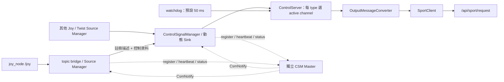

# Control Server 現行架構、服務與控制權仲裁

查核日期：2026-10-19。本文描述 `rv2_server_control` R1 v0.1.1，已合併 `r1` commit `38cfa0f233eb1343e77b54ae97790d01171118fc`；程式內容與原 v0.1.1 tag `c3a2794` 相同。依賴基線為 transport v0.2.0／`5a91d31`、`r1_interfaces` v0.1.2／`a0530d7`。

## 1. 目前行為摘要

- Server 接收已註冊來源的 Joy／Twist，在**同一種訊息型別內**選一個 active channel，再轉成 Unitree sport request。
- 健康的 active 不會被較高 priority 的**普通資料**搶走。較高 priority 的來源要送 **request-active 訊號**才會接管；相等 priority 不可接管。
- 普通收訊／watchdog 發現 active 不可用時，選 priority 最高的可用來源，同分依 channel 字典順序選擇；request-active 在沒有可用 active 時則直接選請求者。
- **目前沒有切換 controller 的 ROS service。** `setActiveSink<T>()` 是 C++ API，production node 沒有把它包成 RPC。
- **急停不比較 priority，也不限 active 來源；沒有鎖存。** 收到後發 StopMove，其他可用來源之後仍可能輸出運動命令。
- **Joy 與 Twist 沒有共同的全域控制權仲裁。** 兩者可各自有 active，最後都寫入同一個 `/api/sport/request`。

下文的「active」指 server 選中的控制來源；R1 status 的 `STATE_ACTIVE` 只表示訊號存活，兩者不能混用。

## 2. 組件與資料流



| 組件 | 目前責任 | 主要實作 |
|---|---|---|
| `ControlServerNode` | 讀取參數、建立 server、註冊 Joy／Twist callbacks，連接 Unitree 輸出與 log | [control_server.cpp](../src/control_server.cpp) |
| R1 `ControlSignalManager` | 管理來源註冊、建立 Sink、接收資料、追蹤存活狀態、與 master 對帳 | transport 的 `r1/control_signal_manager.h` |
| `ControlServer` | 記錄每個 channel 最近收訊時間、選 active、處理 request-active／急停／失聯 | [control_server.h](../include/rv2_server_control/control_server.h) |
| `OutputMessageConverter` | 將 active 的普通訊息轉為動作，保存 Joy 按鍵與速度去重狀態 | [output_message_convert.h](../include/rv2_server_control/output_message_convert.h) |
| `SportClient` | 發布 `unitree_api/msg/Request`，例如 Move、StopMove | [sport client](../thirdparty/unitree_ros2_client/ros2_b2_sport_client.cpp) |
| CSM Master | 偵測 Manager 存活與兩端註冊不一致，通知相關 Manager；不選擇機器人的 active controller | transport 的 `r1/csm_master.h` |

Transport 傳遞 priority，但不替 consumer 仲裁；選擇政策在 `ControlServer`。Core mutex 會序列化收訊仲裁、watchdog 與 output callbacks，callback 應保持簡短且不阻塞。

[Production launch](../launch/control_server.launch.py) 預設另外啟動一個 master；已有 master 時用 `start_master:=false`。直接 `ros2 run rv2_server_control control_server` 不會啟動 master。

## 3. 目前提供哪些 services

### 3.1 Server 固定持有的 R1 管理服務

以下以根 namespace、`server_name=control_server` 為例。程式使用 `<server_name>/...`；預設是相對名稱，會加上 node namespace。若 `server_name` 以 `/` 開頭則為絕對名稱，不再前置 namespace；ROS remapping 仍可改變最終名稱。

| 預設 service | 型別 | 作用 |
|---|---|---|
| `/control_server/control_signal_manage` | `r1_interfaces/srv/ControlSignalManage` | Source Manager 註冊／取消註冊；server 建立／移除對應 Sink |
| `/control_server/control_signal_info_req` | `r1_interfaces/srv/ControlSignalInfoReq` | 空 request；查詢已註冊 endpoint 的完整 `source_list`／`sink_list` |
| `/control_server/get_notifications` | `r1_interfaces/srv/CsmNotify` | 接收 master 主動送來的異常／註冊不一致通知；雖然名稱是 get，實際是接收通知的入口 |

`control_signal_manage` 的 `op=0` 是 REGISTER，`op=1` 是 UNREGISTER。Request 包含 `source_manager_name`、`source_csm_instance_id`、`registration_id`、`attempt_generation` 與 `info`。REGISTER 需要完整描述；UNREGISTER 必須匹配原註冊 identity 三元組，不能只填 controller 名稱就刪除任意來源。

Response 包含 `response` 與 `reason`：0 SUCCESS、1 RETRYABLE_CONFLICT、2 TEMPORARY_UNAVAILABLE、3 PERMANENT_REJECTION、4 ALREADY_APPLIED、5 STALE、6 ERROR。**註冊成功只代表建立傳輸 endpoint，不代表取得 active 控制權。** 新註冊但尚未收到資料的來源不會自動被選中。一般應由 R1 Source Manager／handle 操作註冊，以維持 identity 與重試流程。

Info 查詢通常會看到 server 的 `sink_list`；production node 沒有建立控制資料 Source，因此 `source_list` 通常為空。Response 的結果碼為 SUCCESS／ERROR，沒有「目前 active controller」欄位。

`CsmNotify` 的 request 包含通知 `kind`、`peer_csm_health`、`event_id`、目標 incarnation 與 `EntryStatus[] entries`。通知種類為 STATE、CSM_TIMEOUT、DISCONNECTED、PAIR_MISSING；response 為 APPLIED、ALREADY_APPLIED、STALE、REJECTED 與 reason。這是生命週期協調，不是指定 active controller 的命令。

### 3.2 依 channel 動態建立的資料服務

| Source descriptor | Server 建立的 endpoint | Request／response |
|---|---|---|
| `type=joy, mode=service` | 名稱為 `channel_name`，型別 `r1_interfaces/srv/ControlSignalJoy` | Request：`sensor_msgs/msg/Joy data`；response：結果碼與 reason |
| `type=twist, mode=service` | 名稱為 `channel_name`，型別 `r1_interfaces/srv/ControlSignalTwist` | Request：`geometry_msgs/msg/Twist data`；response：結果碼與 reason |
| `mode=topic` | 名稱為 `channel_name` 的 Joy／Twist subscription | 沒有該 channel 的資料 service |

資料服務定義了 SUCCESS=0、REJECTED=1，但目前 Sink handler 在 `_store(req->data)` 後固定回覆 `SRV_RES_SUCCESS`，沒有將 server 仲裁結果放入 response。待命來源、priority 不夠的 request-active，或未產生 Unitree 輸出的訊息，都可能得到 service SUCCESS。**這不是取得控制權或機器人完成動作的 ACK。**

R1 bridge 預設 `controller_name=local_xbox`、`channel_name=topic_bridge_control`、`csm_mode=topic`、priority 80。因此 `/topic_bridge_control` 預設是資料 topic，不能當資料 service 呼叫。Server 也不會直接訂閱 `/joy`；bridge 先讀 `/joy`，再經已註冊的 channel 轉送。

### 3.3 Master 與 ROS 標準服務

| Service | 型別 | 持有者／用途 |
|---|---|---|
| `/csm_master/register` | `r1_interfaces/srv/CsmRegister` | 獨立 master 接受 Manager 名稱、instance ID、timeout／週期等設定；不是 controller 註冊 |
| `/csm_master/heartbeat` | `r1_interfaces/srv/CsmHeartbeat` | 獨立 master 接受 Manager 名稱與 instance ID 的 heartbeat |

Jazzy standalone node 使用預設 NodeOptions 時，另有下列標準服務：

| 預設 service | 型別 |
|---|---|
| `/control_server/describe_parameters` | `rcl_interfaces/srv/DescribeParameters` |
| `/control_server/get_parameter_types` | `rcl_interfaces/srv/GetParameterTypes` |
| `/control_server/get_parameters` | `rcl_interfaces/srv/GetParameters` |
| `/control_server/list_parameters` | `rcl_interfaces/srv/ListParameters` |
| `/control_server/set_parameters` | `rcl_interfaces/srv/SetParameters` |
| `/control_server/set_parameters_atomically` | `rcl_interfaces/srv/SetParametersAtomically` |
| `/control_server/get_type_description` | `type_description_interfaces/srv/GetTypeDescription` |

R1 管理端點 prefix 由 `server_name` 決定，標準服務 prefix 則來自 **ROS node 名稱**。改 `server_name` 不會自動改 node name。Master 的 R1 prefix 預設 `csm_master`，它自己的 node name 是 `csm_master_node`。使用 component container 時，還可能看到 container 自己的服務；logger services 並非 NodeOptions 預設啟用項目。

目前 production node 沒有 `ControlServerReq`、set-active、get-active、修改 priority 或解除鎖存急停的專用 ROS service。標準參數服務不能替代它們：server 設定在建構時讀取，沒有將參數變更套用到仲裁狀態的 callback。`set_parameters` 成功不表示 Manager 已重建或控制權已切換。

## 4. controller、channel、priority 分別代表什麼

R1 `ControlSignalInfo` 有八個欄位：

| 欄位 | 在目前 server 的用途 |
|---|---|
| `controller_name` | Manager 查找 Sink、識別來源的 key |
| `channel_name` | 真正資料 topic／service 名稱，也是 server 每個 type 的 records／active key |
| `target_manager_name` | 接收註冊的 Manager；預設 `control_server` |
| `mode` | `topic` 或 `service` |
| `type` | 訊息型別 key；production node 處理 `joy` 與 `twist` 的動作輸出 |
| `priority` | 1–100，越大越優先；用於 request-active 與候選來源選擇 |
| `timeout_ns` | 控制資料過期門檻；server 按本地最後收訊時間檢查 |
| `disconnect_timeout_ns` | Transport 判定端點終止並移除的門檻 |

每個來源應使用不同的 controller／channel 名稱。`getActiveSink<T>()` 回傳 **channel_name**；`setActiveSink<T>(channel)` 也接受 channel 名稱。預設 bridge 的 controller 與 channel 分別是 `local_xbox`、`topic_bridge_control`。

Priority 是來源註冊描述的一部分。Server 沒有載入 `requester_priority.yaml`，也沒有 LOCAL／REMOTE 類別上限、95–99 保留區或 priority 100 急停特權。它不要求不同來源的 priority 互異。變更 priority 需由來源端更新描述／註冊流程；對同一 identity 重送 REGISTER 不是修改 priority 的 RPC。

## 5. 收到一封資料時的判斷順序

`registerTypeConfig<T>()` 安裝的 callback 依序執行：

1. 取得 `controller_name` 對應的 Sink handle；無效或已 DISCONNECTED 就忽略。
2. 更新該 channel 的描述、handle 與本地收訊時間，先清除它之前的 `blocked` 標記。同名端點重建時另外清理舊輸出狀態。
3. **先判斷急停**：將發送者設為 blocked，從其餘可用來源重新選 active，發 StopMove，結束此封訊息。
4. **再判斷 request-active**：無可用 active 就直接選請求者；有則只有請求者 priority 嚴格較高才切換。無論成功與否，此封都不進入普通動作轉換。
5. **最後處理普通資料**：若 active 不可用，先選最高 priority 的可用候選；只有這封的 channel 正是 active，才呼叫 output callback。

非 active 的普通資料仍會刷新自身收訊紀錄，讓它成為可用 fallback；只是不送到機器人。沒有 active 時，第一封可用普通資料通常就取得控制權，不必等所有來源都註冊後再選全體最高 priority。

### 5.1 request-active 與急停編碼

| 訊息 | request-active | 急停 |
|---|---|---|
| Joy | `buttons[11] == 1`；不足 12 個按鍵則不成立 | axes 至少 6 個且 `axes[5] < 0.5`，對應目前 R2 mapping |
| Twist | `linear.z`、`angular.x`、`angular.y` **全部等於 99** | 同三個欄位**全部等於 -99** |

Joy 同時滿足兩者時，先走急停。Twist sentinel 不作一般 Move 值；普通運動使用 `linear.x`、`linear.y`、`angular.z`。

Joy request-active 是持續按住的電平判斷，不是按下邊緣。持續送 `buttons[11]=1` 只會持續請求／保活，不輸出 Move；取得控制權後要再送普通訊息才進入動作轉換。

### 5.2 何謂「可用」來源

`usable()` 要求：未 blocked、handle 有效、狀態非 DISCONNECTED，且未超過本地最後收訊時間加 `timeout_ns`。它不要求 Manager 狀態剛好等於 `STATE_ACTIVE`：Manager 在自己的 tick 更新狀態，新資料到達時 status 可能暫時仍是 INITIAL／TIMEOUT。

`timeout_ns=0` 停用資料 timeout；R1 service mode 不接受 0，topic mode 才可使用。`disconnect_timeout_ns=0` 停用自動斷線移除。兩門檻都從最後活動時間計算；非零 disconnect 必須大於非零 timeout。

## 6. 切換條件與優先權範例

| 觸發情況 | 選擇規則 | 輸出行為 |
|---|---|---|
| 無可用 active，收到普通資料 | 在已有新鮮紀錄中挑最高 priority | 若本封來自選中的 channel，就進入 output callback |
| Active 健康，其他來源送普通資料 | 保持原 active，即使來訊 priority 較高 | 只更新候選紀錄 |
| 收到 request-active | 無可用 active 就選請求者；有則必須嚴格較高 priority | 換手先停止舊輸出，再等新 owner 的普通資料 |
| Watchdog 發現 active 過期／失效 | 最高 priority 可用候選；同分按 channel 字典順序；沒有則清空 | 停止舊輸出，不重播候選最後一封資料 |
| C++ `setActiveSink<T>(channel)` | 同 type 的指定 channel 可用即可，**不比較 priority** | 可手動選較低 priority；成功換手後等其新普通資料 |
| 收到急停 | 封鎖發送者，再選最高 priority 的其他可用候選 | 直接發 StopMove，該封不送普通輸出 |

一般換手時，若舊來源曾進入 output callback，`stopPrevious()` 會先發一次 StopMove，再更新 active、清除 converter 狀態。切換本身不重播快取命令。切到相同 channel 時一般不重複換手；同名端點重建另有狀態清理流程。

`hadOutput` 記錄是否曾進入 output callback，不是 robot 是否實際收到 Move。即使 converter 因零值／同值去重而沒有發布，後續失聯仍可能 StopMove。

以下來源都是 Joy，候選資料尚未過期；數字僅示範規則，並非內建角色表。

| 狀況 | 結果 |
|---|---|
| A priority 20 先送普通資料，B priority 80 後送普通資料 | A 保持 active；B 待命 |
| B priority 80 再送 request-active | B 接管，先停止 A；B 下一封普通資料才可輸出 |
| A priority 20 對健康的 B priority 80 送 request-active | 不切換 |
| C priority 80 對健康的 B priority 80 送 request-active | 不切換，必須嚴格較高 |
| B 失聯，A priority 20 與 C priority 80 仍有新鮮資料 | 選 C；不是恢復最早取得控制權的 A |
| B 失聯，`alpha` 與 `beta` 同 priority 且可用 | 選 `alpha`，比較的是 channel 名稱 |
| 程式對可用的 A 呼叫 `setActiveSink<Joy>(A_channel)` | A 可取代較高 priority 的 B；此 API 不是 ROS service |

## 7. 急停、失聯與跨型別的邊界

**R2／Twist sentinel 急停與「X 按鍵 StopMove」是不同路徑。** R2／sentinel 在 active 篩選前處理，任何有有效端點的來源都能觸發，不比較 priority。X 屬於 active Joy 的普通動作轉換；非 active 的 X 不會通過輸出篩選。

X 的 StopMove 不切換 active，也不重設速度去重狀態。因此按 X 停止後，如果後續速度值完全相同，未必會重新發布 Move；不能把它等同於仲裁急停後的同值恢復流程。

急停將發送者 blocked 並重新選候選，也可能把控制權從原本健康的低 priority active 轉給待命的高 priority 來源。發送者下一封非急停訊息會解除自己的 blocked；其他選中來源下一封普通訊息也能再次 Move。沒有「必須呼叫解除急停 service 才能恢復」的鎖存狀態。

每一封明確急停都執行 stop callback，連續急停可能連續發 StopMove。「只停一次」指失聯後沒有新的輸出活動時，不在每個 watchdog tick 重複停止。

Joy 與 Twist 各有 active，但共用 SportClient 與輸出 topic。Joy priority 80 不會壓過 Twist priority 20；兩者都可能輸出。一種 type 的失聯／急停向共用輸出發 StopMove，卻不取消另一 type 的 active，另一 type 之後仍可 Move。仲裁的 stop callback／activeChanged callback 也會清空同一 converter 內 **Joy 與 Twist 全部**去重狀態。這些是目前實作行為，不是全域單一 owner 或全域鎖存急停。

## 8. 時間設定與輸出

| 設定 | 預設 | 含義 |
|---|---|---|
| `watchdog_interval_ms` | 50 ms | Server 檢查 active 資料是否可用的週期 |
| `status_timer_interval_ms` | 100 ms | R1 Manager tick／status 週期 |
| `csm_timeout_ms` | 600 ms | Master 判斷本 Manager heartbeat 過期並標記 TIMEOUT 的門檻，不是 Joy 資料 timeout |
| `csm_disconnect_timeout_ms` | 6000 ms | Master 判斷本 Manager 已死亡、通知配對 Manager 移除相關端點的門檻 |
| Source `timeout_ns` | 來源決定 | 目前 R1 bridge 的 `timeout_ms=2000` |
| Source `disconnect_timeout_ns` | 來源決定 | 目前 R1 bridge 的 `disconnect_timeout_ms=10000` |

Master 依最後收到本 Manager heartbeat 的時間判斷存活；上述兩個 CSM 門檻不表示 server 等待 master 回覆的時間。Server 預設值見 [control_server.yaml](../config/control_server.yaml)。實際停止時間還受 executor 排程、callback 與 watchdog 檢查時間影響，50 ms 不是端到端停止保證。

Active Joy 的 axes 0／1／3 轉成 Move x／y／yaw；A／B／X／Y 按下事件分別轉成 StandUp／StandDown／StopMove／RecoveryStand。Active Twist 使用 linear.x／linear.y／angular.z。相同 Move 值不重複發布，初始全零通常不發 Move。換手、仲裁 stop callback（急停／失聯）或端點重建會重設轉換狀態，重新收到相同非零值仍能恢復輸出；X 的普通 StopMove 不走這個 reset。

輸出是 `/api/sport/request` 的 `unitree_api/msg/Request` **topic**，不是 ROS service。現行路徑發布命令，不等待機器人完成確認。它是絕對 topic 名稱，替 server 換 namespace 不會自動將 robot 輸出隔離成不同 topic。

## 9. 如何觀察目前狀況

以下為讀取／觀察命令，名稱依實際 namespace 調整：

```bash
ros2 node info /control_server
ros2 service list -t
ros2 service call /control_server/control_signal_info_req \
  r1_interfaces/srv/ControlSignalInfoReq '{}'
ros2 topic echo /control_server/status
ros2 topic echo /api/sport/request
```

| 觀察內容 | 能回答的問題 | 不能直接推論的事情 |
|---|---|---|
| Info 的 `sink_list` | 哪些來源已註冊，channel／priority／timeout 為何 | 哪個目前有控制權 |
| `ManagerStatus.sinks` 的 state／data_rate_hz | 傳輸存活狀態與收訊頻率 | `STATE_ACTIVE` 不等於被選中 |
| `[R1/joy] active channel: ...`、`[R1/twist] ...` | 各 type 的 active 切換 | 不表示已發布 Move |
| `[OUTPUT/joy]`／`[OUTPUT/twist]` | Converter 產生並呼叫輸出命令，可看 controller／channel／priority | 不表示機器人已完成動作 |
| `[STOP/joy]`／`[STOP/twist]` 與 API 1003 | StopMove 已被呼叫／發布 | 不表示全域控制權被鎖住 |

嵌入 library 時可用 `getActiveSink<sensor_msgs::msg::Joy>()` 與 `getActiveSink<geometry_msgs::msg::Twist>()` 查詢；production node 沒有額外發布這兩個 active 值。`log_output=false` 關閉一般 OUTPUT log，切換與 STOP log 仍保留。

## 10. 程式與既有測試對照

| 要追查的行為 | 入口 |
|---|---|
| 收訊順序、手動選擇、usable／best／select／watch | [control_server.h](../include/rv2_server_control/control_server.h) |
| 預設 request-active／急停編碼 | [control_signal_detect.h](../include/rv2_server_control/control_signal_detect.h) |
| Output／Stop／activeChanged callbacks 與參數 | [control_server.cpp](../src/control_server.cpp) |
| Converter reset、Twist 同值去重 | [output_message_convert.h](../include/rv2_server_control/output_message_convert.h) |
| Joy 按鍵／axes 轉換 | [joy_sport_client_map.h](../include/rv2_server_control/joy_sport_client_map.h) |
| Type 獨立、priority 100、request-active、fallback、急停與恢復 | [integration tests](../test/integration/test_control_server.cpp) |
| 編碼邊界、短 Joy arrays、轉換與 reset | [unit tests](../test/unit/test_control_server.cpp) |

固定依賴版本的定義與建立位置：

- [r1_interfaces srv](https://github.com/cocobird231/r1_interfaces/tree/a0530d76cb69a737778ec1b658682837a50a738a/srv)、[msg](https://github.com/cocobird231/r1_interfaces/tree/a0530d76cb69a737778ec1b658682837a50a738a/msg)。
- [ControlSignalManager](https://github.com/cocobird231/rv2_control_signal_transport/blob/5a91d316146e2f3cb52e77002faec139735ba61c/include/rv2_control_signal_transport/r1/control_signal_manager.h)、[ControlSignalSink](https://github.com/cocobird231/rv2_control_signal_transport/blob/5a91d316146e2f3cb52e77002faec139735ba61c/include/rv2_control_signal_transport/r1/control_signal_sink.h)、[CSM Master](https://github.com/cocobird231/rv2_control_signal_transport/blob/5a91d316146e2f3cb52e77002faec139735ba61c/include/rv2_control_signal_transport/r1/csm_master.h)。
- [R1 bridge 預設設定](https://github.com/cocobird231/rv2_csm_topic_bridge/blob/78ba1a94825eb9790f23a3be5dbfb31df5162ec7/config/topic_bridge.yaml)。
- Jazzy 標準服務：[parameter services](https://github.com/ros2/rclcpp/blob/jazzy/rclcpp/src/rclcpp/parameter_service.cpp)、[type-description service](https://github.com/ros2/rclcpp/blob/jazzy/rclcpp/src/rclcpp/node_interfaces/node_type_descriptions.cpp)。

本文由目前源碼與既有測試案例整理；引用測試不代表本次重跑。相同 priority 的 fallback 排序、非 active 急停、手動選較低 priority，以及兩種 type 共用機器人輸出的交互行為，係從實作直接推導，現有測試沒有逐項獨立覆蓋。
